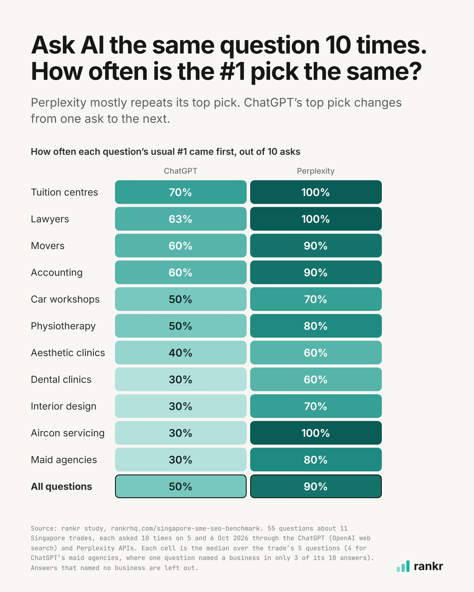
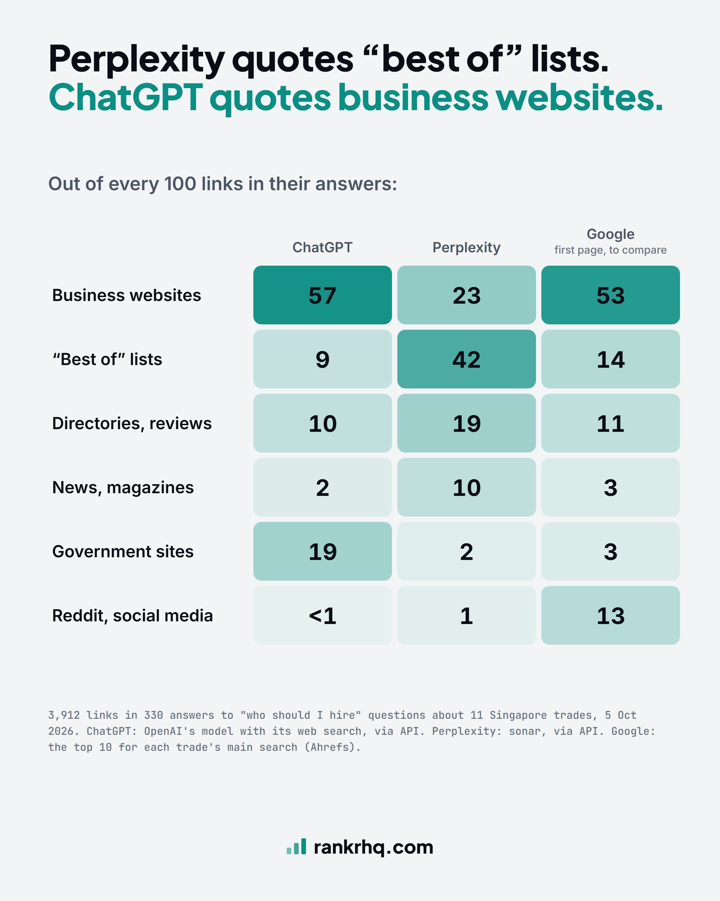
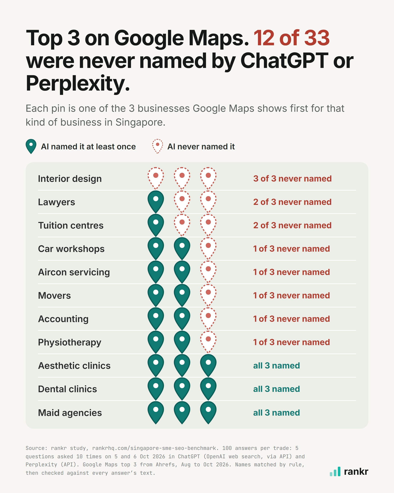

<p align="center">
  <a href="https://rankrhq.com"></a>
</p>

<h1 align="center">Who ChatGPT and Perplexity recommend in Singapore</h1>

<p align="center">
  1,300 AI answers about 15 Singapore trades, every one of them downloadable.<br>
  <a href="https://rankrhq.com/chatgpt-recommendations-singapore">Read the study</a> ·
  <a href="#the-files">Get the data</a> ·
  <a href="#how-to-cite">Cite it</a>
</p>

<p align="center">
  
  
  
</p>

---

We asked ChatGPT, ten times in a row, *"Can you recommend a good aircon servicing company in Singapore?"*

| Ask | 1 | 2 | 3 | 4 | 5 | 6 | 7 | 8 | 9 | 10 |
|---|---|---|---|---|---|---|---|---|---|---|
| First business named | LM Brothers Aircond | 338 Aircon | SoCool | LM Brothers Aircond | Natural Cool | Cool Aircon | Lion City Aircon | Lion City Aircon | SoCool | 338 Aircon |

Six different companies came first, and none more than twice. That one question is the whole study in miniature,
so we asked 75 questions like it about 15 trades and kept every answer.

<p align="center">
  
</p>

## What we found

1. **Ask again and the first pick changes.** Over ten asks of the same question, ChatGPT's first pick changed
   at least once for 50 of 54 questions (93%) and Perplexity's for 35 of 55 (64%), in the 11 trades asked of
   both. Across all 15 trades, ChatGPT's changed for 65 of 74 (88%).
2. **A few businesses get named again and again.** In each of the 15 trades, the most-named business appeared
   in between 29% and 78% of the trade's answers (Move Move Movers in 78 of 100 movers answers, Noel Gifts in
   35 of 50 corporate gift answers). Over ten runs of the 11 trades asked of both assistants, 364 of the 911
   businesses named (40%) appeared in only one answer.
3. **The two assistants rarely agree.** Of the 808 businesses named for a question in the first three runs,
   140 (17%) were named by both ChatGPT and Perplexity.
4. **They read different sources.** 42% of Perplexity's citations were "best X in Singapore" lists (1,311 of
   3,109). 57% of ChatGPT's were the websites of businesses in the trade (460 of 803).
5. **A top spot on Google Maps does not carry over.** Neither assistant named 12 of the 33 businesses in
   Google's top three map results in any of the 1,100 answers.

<table>
  <tr>
    <td width="50%"></td>
    <td width="50%"></td>
  </tr>
</table>

## How we asked

Eleven trades were asked of both assistants on 5 and 6 October 2026: 55 questions, 1,100 answers. Four more,
property agents, cafes and restaurants, F&B suppliers and corporate gift companies, were asked of ChatGPT on
18 November 2026: 20 questions, 200 answers.

- **Questions.** Five templates per trade, the same for every trade: "Can you recommend a good {provider} in
  Singapore?", "What are the best {providers} in Singapore?", a real search typed as is (the highest-volume
  candidate keyword containing "singapore"), "I need an affordable {provider} in Singapore. Who should I go
  to?" and "I live in Tampines. Which {provider} near me would you recommend?". 75 questions over 15 trades.
- **Assistants.** ChatGPT means OpenAI's gpt-5.6-luna with OpenAI's own web search; Perplexity means its sonar
  model, which searches Perplexity's own index. Every question was sent alone, with no system prompt, no
  history and no location. October: both through OpenRouter, runs 1 to 3 from 23:18 to 23:28 on 5 October and
  runs 4 to 10 from 01:20 to 01:41 on 6 October (Singapore time). November: ChatGPT through OpenAI's API with
  its web search on and nothing else, from 01:47 to 01:55 on 18 November.
- **Plans first.** `frame.md`, `frame-wave2.md` and `frame-wave3.md` were each saved before the first question
  of their round was sent. `notes.md` and `notes-wave3.md` record everything decided afterwards, with the
  reason.
- **Coding.** A small model (gpt-5-nano, no web access) listed the businesses each answer names, and a name was
  kept only if that exact text appears in the answer, so the model could miss a name but never add one. A hand
  check of 20 answers found 99 names, none missed and none invented. Names were matched within a trade after
  lowercasing and dropping "Pte Ltd", "Singapore" and punctuation, counting a branch name as the same business.
- **Figures.** A question's first pick is the first business an answer names. A question counts in the
  first-pick figures when at least five of its ten answers named a business. A trade's most-named business is
  the one named in the most of its answers. Each cited link has one label by fixed rules (forums and social
  media, government, best-of lists, then the website's own hand-reviewed label).
- **Cost.** US$5.02 for runs 1 to 3, US$12.02 for runs 4 to 10 and US$4.24 for the four November trades, in API
  calls.

## What this can't tell you

- The answers come from the APIs. The ChatGPT and Perplexity apps add their own instructions, memory and the
  user's location, and may use another model.
- Each round fell on one night, so the figures show how answers move from one ask to the next, not how they
  change over weeks.
- Ten answers per question is a small sample: 100 answers per trade asked of both assistants, 50 per trade
  asked of ChatGPT alone. Per-trade and per-question figures are descriptive.
- The four November trades were asked of ChatGPT only, so figures that compare the two assistants, label cited
  sources or check Google's results cover the 11 October trades.
- English only, and the Tampines question names one town.
- A business called two different names in two answers counts as two, which pushes agreement down.
- Google's results are Ahrefs captures from 11 August to 5 October 2026, not all on the same day. The November
  trades' searches were picked from Google Ads volumes through DataForSEO.
- Websites first cited after runs 1 to 3 have not been hand-labelled and are marked `Not labelled`; no
  published figure uses them.
- Some checks came after a plan was saved: Google's map results over ten runs and the text search behind them,
  the by-trade summaries, Google's first page over all ten runs (16 October 2026), and the ten-run first-pick
  figures for the four November trades (18 November 2026). The notes files record each one.

## The files

Start with `answers.csv` if you want a spreadsheet, or `answers-full.jsonl` if you want every answer word for word.

**`data/wave1/`**: the 11 trades, runs 1 to 3, both assistants (5 October 2026)

| File | What it holds |
|---|---|
| `answers-full.jsonl` | Every answer in full, with the names and labelled sources coded from it |
| `answers.csv` | One row per answer: question, assistant, model, run, time, businesses named, citation count |
| `citations.csv` | One row per cited source, with its domain and label |
| `questions.csv` | The 55 questions, exactly as sent |
| `google-serps.json` | Google's map results and top 10 for each trade's search, with capture dates |
| `domain-labels.json` | The label given to every cited website |
| `frame.md` | The study design, saved before the first question was sent |
| `notes.md` | What changed after that, and why |
| `results.json` | Every figure from runs 1 to 3, with its numerator and denominator |

**`data/wave2/`**: the same 11 trades, runs 4 to 10 (6 October 2026)

| File | What it holds |
|---|---|
| `answers-full-wave2.jsonl` | Every answer in full, with its names and sources |
| `answers-wave2.csv` | One row per answer, in the `answers.csv` columns |
| `frame-wave2.md` | The plan for runs 4 to 10, saved before they were sent |
| `results-wave2.json` | Every ten-run figure, each question's first picks, and the map-pack text search |
| `results-page-one-all-runs.json` | Google's first page over all ten runs, by trade and assistant |

**`data/wave3/`**: property agents, cafes and restaurants, F&B suppliers and corporate gift companies, runs 1
to 10, ChatGPT (18 November 2026)

| File | What it holds |
|---|---|
| `answers-full-wave3.jsonl` | Every answer in full, with its names and sources |
| `answers-wave3.csv` | One row per answer, in the `answers.csv` columns |
| `citations-wave3.csv` | One row per cited source, in the `citations.csv` columns |
| `questions-wave3.csv` | The 20 questions, exactly as sent |
| `frame-wave3.md` | The plan for the four trades, saved before the first question was sent |
| `notes-wave3.md` | What was seen and decided after that |
| `results-wave3.json` | Every figure for the four trades, each question's first picks, and ChatGPT over all 15 trades |

## How to cite

Vulla, A. and Lee, A. (2026). Who ChatGPT and Perplexity recommend in Singapore, version 1.1. rankr. 1,300 AI
answers collected 5 and 6 October and 18 November 2026. https://rankrhq.com/chatgpt-recommendations-singapore

```bibtex
@misc{rankr2026aisingapore,
  author    = {Vulla, Abhishek and Lee, Abel},
  title     = {Who ChatGPT and Perplexity recommend in Singapore},
  year      = {2026},
  version   = {1.1},
  publisher = {rankr},
  url       = {https://rankrhq.com/chatgpt-recommendations-singapore},
  note      = {Dataset, CC BY 4.0}
}
```

GitHub's "Cite this repository" button reads the same details from `CITATION.cff`.

## Licence

Creative Commons Attribution 4.0 International (CC BY 4.0). Share and adapt the data for any purpose,
including commercially, with credit to rankr and a link to the study. See `LICENSE`. The charts are free to
reuse on the same terms.

## Versions

- **6 October 2026, version 1.0.** Published with runs 1 to 3: 330 answers from the evening of 5 October.
- **6 October 2026.** Runs 4 to 10 added, 770 answers, so every October question was asked ten times.
- **16 October 2026.** Google's first page counted over all ten runs.
- **18 November 2026, version 1.1.** Four trades added, asked of ChatGPT only: property agents, cafes and
  restaurants, F&B suppliers and corporate gift companies, 200 answers.

---

Made by [Abhishek Vulla](https://rankrhq.com/about#abhishek-vulla) and [Abel Lee](https://rankrhq.com/about#abel-lee)
at [rankr](https://rankrhq.com), an SEO and AI search agency in Singapore.
